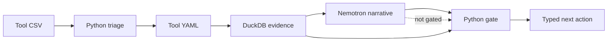

# What is FabAgent?

FabAgent is a troubleshooting copilot for semiconductor process engineers. It
takes a tool export (CSV), checks the channels named in a tool-specific YAML
configuration, and returns a **typed next step** for a human to review.

It is deliberately **evidence-gated**: the model may explain what it sees, but
Python decides whether the configured candidate is supported, insufficient, or
vetoed.

## What you do as a fab engineer

1. **Choose a dataset or upload a raw tool CSV.** The first rows are previewed so
   you can confirm the export before running anything.
2. **Read the column guide.** It explains what the important channels mean.
3. **Review the YAML configuration.** The YAML names the channels, thresholds,
   candidate claim, and the typed action allowed when the candidate is supported.
4. **Choose live services in the sidebar.** Nemotron is on when the server has a
   key. Tavily is optional and only runs for inconclusive or experimental results.
5. **Run the case and watch the checklist.** Each step is marked as it completes:
   CSV read, triage, DuckDB scan, Python checks, model call, gate, Tavily.
6. **Read the verdict and next action.** Open the evidence table if you want to
   audit the numbers. If the result is experimental, review the draft mapping
   before trusting it.

## What FabAgent will not do

- It will not change a process recipe or act on the tool.
- It will not treat a model narrative as evidence.
- It will not claim a physical root cause from an unverified mapping.
- It will not hide a missing channel or an unresolved citation.

> The public samples are demonstration data. They are not field validation and
> they are not a substitute for a tool engineer's review.
